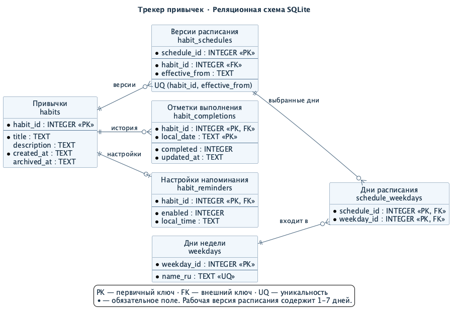

# Лабораторная работа 4. Проектирование и нормализация базы данных

Проект «Трекер привычек», вариант 2. Источник требований — [техническое задание](https://github.com/Wijerty/habit-tracker-srs/wiki/Техническое-задание), разделы 2, 3 и 5. Для проектирования выбрана SQLite 3.37+. База описывает данные одного пользователя и проверяется отдельно от браузерного прототипа, который хранит данные в `localStorage`.

## 1. Предметная область и исходная структура

| Требование ТЗ | Что необходимо хранить |
|---|---|
| § 2.1. Создание, редактирование и архивирование | Название, описание, время создания и архивирования привычки. Выбранные дни недели и дата начала действия расписания |
| § 2.2 и 3. Отметка, отмена и целостность | Единственная запись на пару «привычка + локальная дата», состояние отметки и время её изменения |
| § 2.3 и 2.5. Календарь, серии, статистика | Версии расписания и отметки. Серии и проценты рассчитываются по запросу |
| § 2.4. Напоминания | Признак включения и местное время в формате `HH:MM`. Разрешение на уведомления относится к браузеру |

Воображаемая плоская таблица `Habit_Flat` хранит всё в одной строке:

```text
habit_id, title, description, created_at, archived_at,
status_code, status_label,
reminder_enabled, reminder_time,
{effective_from, {weekday_id, weekday_name}},
{local_date, completed, updated_at}
```

Например, у привычки «Гулять 30 минут» дни `Пн, Ср, Пт` и несколько отметок. Списки в ячейках трудно проверять по отдельности. Если развернуть их в строки одной таблицы, названия, настройки напоминания и подписи статусов будут повторяться на каждую комбинацию версии, дня недели и даты отметки.

- **Аномалия обновления.** Перенос напоминания требует изменить все строки привычки. Часть строк может остаться со старым временем.
- **Аномалия вставки.** В общей таблице с ключом, содержащим дату отметки, нельзя записать новое расписание до появления отметки без фиктивной даты.
- **Аномалия удаления.** При удалении последней строки с отметкой можно потерять описание привычки и её расписание.

## 2. Переход к 1НФ

Каждая ячейка содержит одно значение. По одному дню недели приходится на строку расписания, по одной локальной дате — на строку истории. Для объяснения зависимостей используем два промежуточных атомарных отношения. Их общие данные о привычке пока повторяются.

| Отношение | Ключ | Пример атомарной строки |
|---|---|---|
| `ScheduleDay_1NF` | `(habit_id, effective_from, weekday_id)` | `(2, '2026-11-12', 3, 'Среда', 'Гулять 30 минут')` |
| `Completion_1NF` | `(habit_id, local_date)` | `(2, '2026-11-18', 1, '2026-11-18T15:45:00Z', 'Гулять 30 минут')` |

Одна версия расписания теперь представлена несколькими строками с общим `habit_id` и `effective_from`. Отдельные даты выполнения больше не перемножаются со строками расписания.

## 3. Переход к 2НФ

Устраняем зависимости от части составного ключа:

- `habit_id → title, description, created_at, archived_at` и настройки напоминания. Эти данные выделены в `habits` и `habit_reminders`.
- `weekday_id → weekday_name`. Название дня вынесено в `weekdays`.
- `(habit_id, effective_from) → schedule_id`. Изменения расписания выделены в `habit_schedules`. Одна строка задаёт версию привычки, действующую начиная с указанной даты. Пара `(habit_id, effective_from)` остаётся альтернативным ключом, хотя для ссылок используется `schedule_id`.
- `(habit_id, local_date) → completed, updated_at`. Оба атрибута относятся к конкретной отметке, поэтому остаются в `habit_completions`.

Таблица `schedule_weekdays` содержит только ключевые поля `(schedule_id, weekday_id)`. Набор из семи дней означает ежедневное расписание. Список выбранных дней однозначно задаёт расписание, поэтому отдельное поле `is_daily` не требуется.

## 4. Переход к 3НФ

После выделения таблиц с ключом `habit_id` в промежуточной таблице привычек всё ещё могли оставаться `archived_at`, `status_code` и `status_label`. Код архивного статуса вычисляется из `archived_at`, а текст зависит от кода: `habit_id → archived_at → status_code → status_label`. В итоговой таблице хранится только `archived_at`. `NULL` означает активную привычку. Имя статуса формирует интерфейс.

Текст дня существует только в справочнике `weekdays`. Число выполнений, процент, серия и текущий вид расписания вычисляются по исходным записям. Это устраняет расхождения при отмене отметки и при изменении расписания.

| Таблица | Кандидатные ключи | Основные функциональные зависимости |
|---|---|---|
| `habits` | `habit_id` | Ключ определяет название, описание и даты создания и архива |
| `habit_reminders` | `habit_id` | Ключ определяет `enabled` и `local_time`. Время может быть задано при выключенном напоминании |
| `habit_schedules` | `schedule_id`, `(habit_id, effective_from)` | Каждый из ключей определяет всю строку |
| `weekdays` | `weekday_id`, `name_ru` | Каждый ключ однозначно определяет второй |
| `schedule_weekdays` | `(schedule_id, weekday_id)` | Неключевых атрибутов нет |
| `habit_completions` | `(habit_id, local_date)` | Состояние и время изменения зависят от всей пары |

При принятых правилах модели каждый определитель нетривиальной функциональной зависимости является суперключом соответствующей таблицы. Следовательно, все таблицы удовлетворяют 3НФ.

## 5. Связи и правила целостности

- **1:N** от `habits` к `habit_completions` и `habit_schedules`. Каждая отметка и версия относятся ровно к одной привычке. Составной ключ отметок исключает дубли. Отмена меняет `completed` на `0` и обновляет `updated_at` в той же строке.
- **1:0..1** от `habits` к `habit_reminders`. В настройках `habit_id` одновременно PK и FK. Включённая настройка требует корректного времени.
- **M:N** между `habit_schedules` и `weekdays` через `schedule_weekdays`. Например, версия `21` связана с понедельником, средой и пятницей. Один и тот же день может входить в несколько версий. Составной ключ запрещает повтор одного дня внутри версии.
- Архивирование меняет `archived_at`, восстановление возвращает `NULL`. Отметки и версии при этом сохраняются. Физический `DELETE` привычки каскадно удаляет её зависимые данные. История версий расписания хранится, а `archived_at` отражает текущее архивное состояние.
- `local_date` и `effective_from` относятся к местному календарю пользователя. `created_at`, `archived_at` и `updated_at` записываются в UTC. Будущая интеграция вычисляет местную дату на клиенте и передаёт её явно. SQLite проверяет форматы и связность, а приложение определяет, можно ли менять отметку в выбранный день.
- Создание привычки, версии и её 1–7 дней выполняется одной транзакцией. При редактировании с новой даты добавляется версия, а при исправлении запланированных дней с той же даты используется существующая версия. Проверка минимального числа выбранных дней проводится в приложении. DDL задаёт максимальное число через справочник из семи дней и уникальность пары.

## 6. Финальная схема



- [Исходник PlantUML](../docs/database/er_diagram.puml) · [SVG](../docs/database/er_diagram.svg)
- [Схема и индексы](schema.sql) · [Тестовые данные](seed_data.sql)

| Индекс | Какой запрос поддерживает |
|---|---|
| `idx_habits_active_created` | Список активных привычек (`archived_at IS NULL`) в порядке создания |
| `idx_schedule_weekdays_day` | Поиск версий расписания по выбранному дню недели |
| `idx_completions_date` | История всех привычек за диапазон дат |
| `idx_reminders_enabled_time` | Выбор включённых напоминаний на заданное местное время с последующей проверкой активности и дня недели |

Для истории отдельной привычки уже есть индекс её составного PK `(habit_id, local_date)`. Для определения действующей версии используется уникальный индекс `(habit_id, effective_from)`. Отдельные индексы с тем же началом не дублируются.

## 7. Как проверить

Из корня репозитория создайте **новый** файл БД с помощью SQLite 3.37+:

```bash
sqlite3 -bail habit_tracker.sqlite3 < database/schema.sql
sqlite3 -bail habit_tracker.sqlite3 < database/seed_data.sql
sqlite3 -bail habit_tracker.sqlite3 'PRAGMA integrity_check; PRAGMA foreign_key_check;'
python3 database/verify.py
```

Ожидается `ok` и ноль строк из `foreign_key_check`. Проверка `verify.py` загружает оба скрипта в память, проверяет дубли, несуществующие ссылки, неверную дату и время, смену версии расписания, архивирование и отмену отметки. При открытии нового подключения для записи включайте `PRAGMA foreign_keys = ON` до транзакции. Номер версии схемы — `PRAGMA user_version = 1`.

Например, чтобы получить дни прогулки на 24 ноября 2026 года, найдём последнюю версию не позже нужной даты:

```sql
SELECT w.name_ru
FROM schedule_weekdays AS d
JOIN weekdays AS w USING (weekday_id)
WHERE d.schedule_id = (
    SELECT schedule_id FROM habit_schedules
    WHERE habit_id = 2 AND effective_from <= '2026-11-24'
    ORDER BY effective_from DESC LIMIT 1
)
ORDER BY w.weekday_id;
```

Результат — `Вторник`, `Четверг`. Для даты `'2026-11-22'` тот же запрос возвращает `Понедельник`, `Среда`, `Пятница`: прежний график сохранился. В данных также есть ежедневная привычка, архив с сохранённой отметкой, отменённая отметка, включённое и выключенное напоминания и новая привычка без истории.
