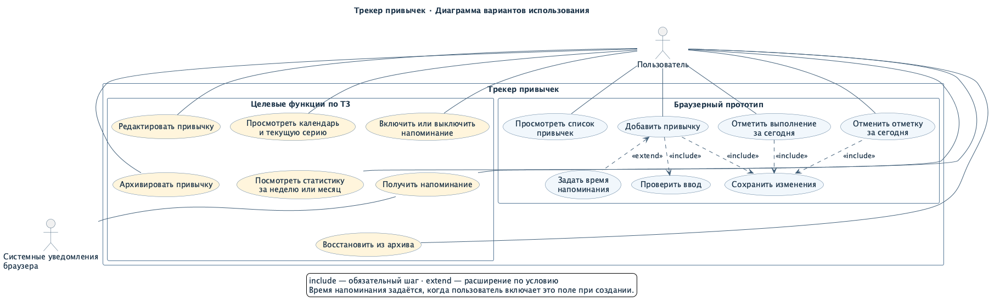
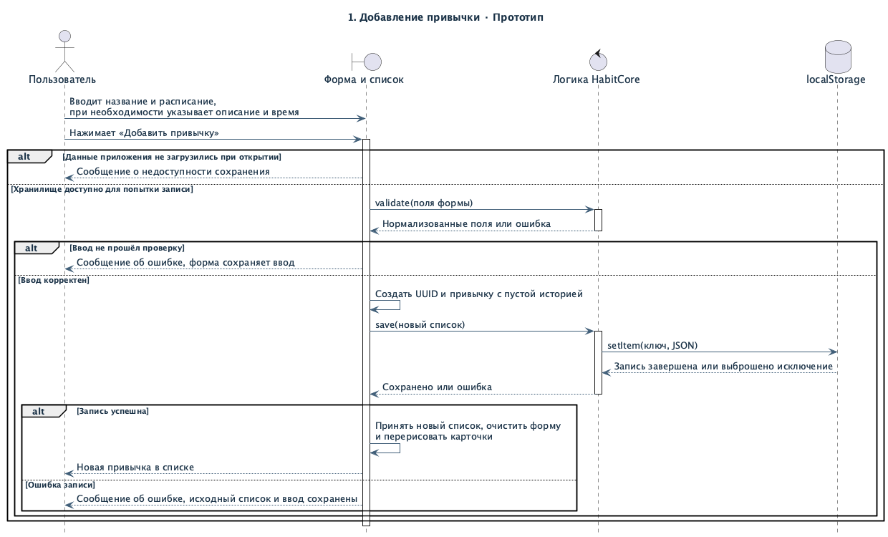
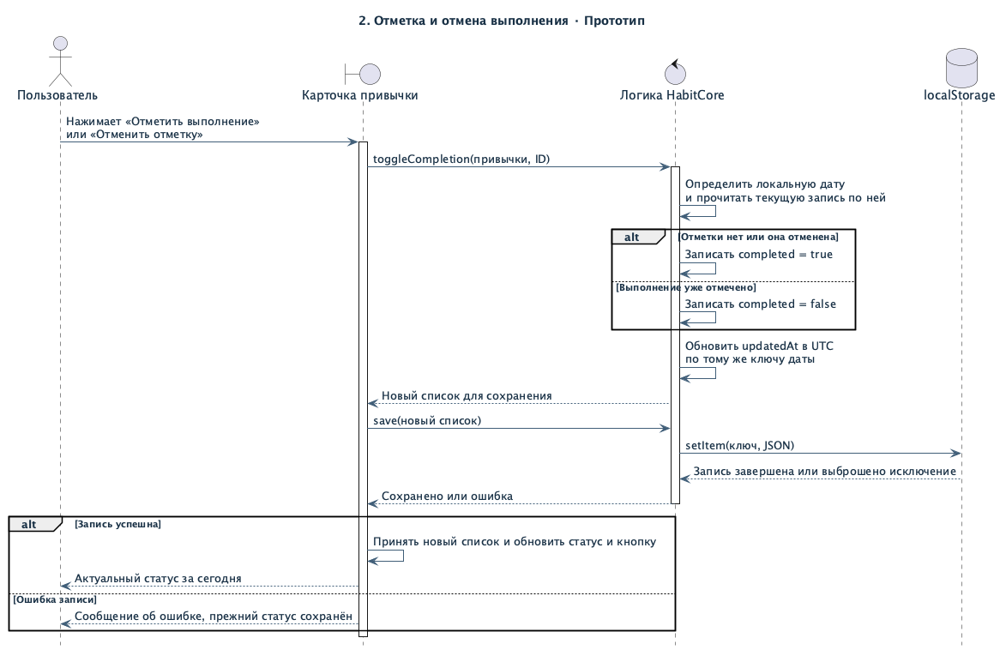
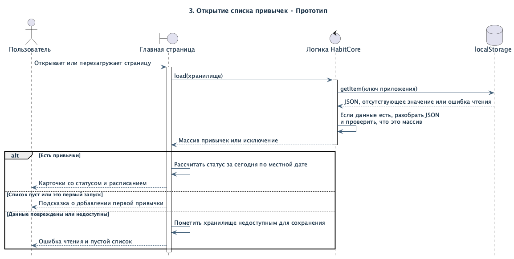
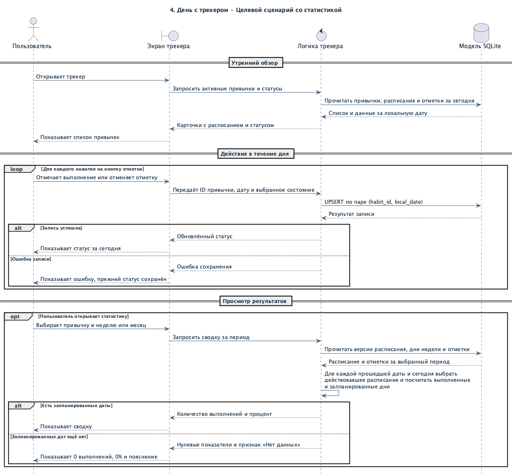

# Лабораторная работа 5. Моделирование поведения

Вариант 2. Проект «Трекер привычек». Use Case диаграмма показывает функции из [ТЗ](https://github.com/Wijerty/habit-tracker-srs/wiki/Техническое-задание) и границы приложения. Диаграммы последовательности показывают порядок действий пользователя, интерфейса, логики и хранилища.

Три сценария описывают [работающий браузерный прототип](../../script.js) с `localStorage`. Четвёртый описывает целевую работу со статистикой на основе [модели SQLite из лабораторной № 4](../../database/normalization.md). Это проектное описание функций из беклога.

## Диаграмма вариантов использования



[PNG](../use_case/use_case_diagram.png) · [SVG](../use_case/use_case_diagram.svg) · [PlantUML](../use_case/use_case_diagram.puml)

- **Пользователь** ведёт личный список привычек. В прототипе он может открыть список, создать привычку с ежедневным или недельным расписанием, отметить выполнение и отменить отметку. Уведомления, календарь, статистика, редактирование и архив отражены в целевой части диаграммы.
- **Системные уведомления браузера** участвуют в доставке напоминания в целевой модели. Доставка зависит от разрешения браузера. В прототипе можно сохранить время напоминания.
- Связь `include` показывает обязательное действие. При создании проверяется ввод. Создание, отметка и отмена требуют сохранения изменений.
- Связь `extend` связывает необязательное указание времени с созданием привычки. Оно добавляется к основному сценарию, когда пользователь включает соответствующее поле формы.

## Диаграммы последовательности

| Сценарий | Состояние | Задачи | Файлы |
|---|---|---|---|
| 1. Добавление привычки | Прототип | [#12](https://github.com/Wijerty/habit-tracker-srs/issues/12), [#13](https://github.com/Wijerty/habit-tracker-srs/issues/13) | [PNG](sequence/add_habit_sequence.png) · [SVG](sequence/add_habit_sequence.svg) · [PlantUML](sequence/add_habit_sequence.puml) |
| 2. Отметка и отмена выполнения | Прототип | [#19](https://github.com/Wijerty/habit-tracker-srs/issues/19), [#20](https://github.com/Wijerty/habit-tracker-srs/issues/20) | [PNG](sequence/toggle_completion_sequence.png) · [SVG](sequence/toggle_completion_sequence.svg) · [PlantUML](sequence/toggle_completion_sequence.puml) |
| 3. Открытие списка привычек | Прототип | [#15](https://github.com/Wijerty/habit-tracker-srs/issues/15) | [PNG](sequence/view_habits_sequence.png) · [SVG](sequence/view_habits_sequence.svg) · [PlantUML](sequence/view_habits_sequence.puml) |
| 4. Ежедневный обзор и статистика | Целевая модель | [#19](https://github.com/Wijerty/habit-tracker-srs/issues/19), [#20](https://github.com/Wijerty/habit-tracker-srs/issues/20), [#25](https://github.com/Wijerty/habit-tracker-srs/issues/25) | [PNG](sequence/daily_workflow_sequence.png) · [SVG](sequence/daily_workflow_sequence.svg) · [PlantUML](sequence/daily_workflow_sequence.puml) |

Стрелки читаются сверху вниз. Блок `alt` показывает альтернативные ветви, `loop` — повторение действия, `opt` — необязательную часть сценария.

### 1. Добавление привычки



Пользователь заполняет форму и нажимает «Добавить привычку». `HabitCore.validate()` проверяет название, выбор дней для недельного расписания и формат времени, если напоминание включено. При успешной проверке интерфейс создаёт UUID и пустую историю отметок. `HabitCore.save()` сохраняет новый список как JSON. После успешной записи интерфейс показывает карточку и очищает форму. При неверном вводе или ошибке записи введённые данные остаются в форме. Если сохранённые данные не удалось прочитать при старте, приложение сообщает о недоступности сохранения.

### 2. Отметка и отмена выполнения



Пользователь нажимает кнопку на карточке. `HabitCore.toggleCompletion()` берёт локальную дату и меняет состояние записи этой привычки. Повторное нажатие отменяет отметку. Ключ даты остаётся прежним, время изменения хранится в UTC. Интерфейс принимает новый список после успешной записи. При ошибке он показывает сообщение и сохраняет прежний статус.

### 3. Открытие списка привычек



При открытии или перезагрузке страницы `HabitCore.load()` читает `localStorage`. Если записей ещё нет, интерфейс предлагает создать первую привычку. Для сохранённых привычек он выводит расписание и статус за текущий день. Ошибка чтения или повреждённый JSON приводят к сообщению об ошибке и блокируют сохранение новой привычки, чтобы не перезаписать данные.

### 4. Ежедневный обзор и статистика



Пользователь открывает список, в течение дня меняет отметки и при желании смотрит результаты за неделю или месяц. В целевой модели запись меняется через `UPSERT` по составному ключу `(habit_id, local_date)`. Для сводки на каждую дату до сегодняшней включительно выбирается версия расписания с самой поздней `effective_from`, которая не превышает эту дату. В расчёт входят запланированные по ней дни. Число выполнений — количество таких дней с действующей отметкой. Процент равен числу выполнений, делённому на число запланированных дней и умноженному на 100. При отсутствии запланированных дней интерфейс показывает нулевые значения с пояснением. Отмена отметки учитывается при следующем расчёте.

## Сборка диаграмм

Диаграммы собраны PlantUML 1.2025.4. Готовые PNG и SVG открываются без установки инструментов. Для перегенерации из корня репозитория нужны Java и файл `plantuml.jar`:

```sh
java -jar plantuml.jar -charset UTF-8 -checkonly docs/use_case/*.puml docs/behavior/sequence/*.puml
java -jar plantuml.jar -charset UTF-8 -tpng docs/use_case/*.puml docs/behavior/sequence/*.puml
java -jar plantuml.jar -charset UTF-8 -tsvg docs/use_case/*.puml docs/behavior/sequence/*.puml
```
