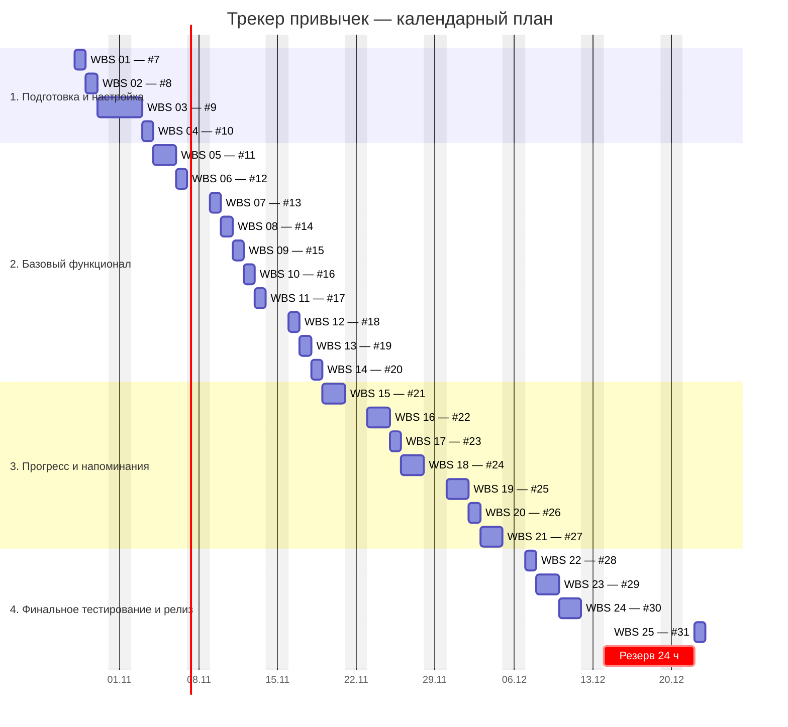

# План проекта «Трекер привычек»

Лабораторная работа 2. Вариант 2. Планирование проекта и управление командой.

**Дата составления:** 27.10.2026. **Плановый период:** 28.10–22.12.2026 (56 календарных дней, 8 недель).

[Техническое задание](https://github.com/Wijerty/habit-tracker-srs/wiki/Техническое-задание) · [Репозиторий](https://github.com/Wijerty/habit-tracker-srs) · [Беклог из 25 задач](https://github.com/Wijerty/habit-tracker-srs/issues?q=is%3Aissue%20label%3A%22lab2%3A%20backlog%22)

## 1. Участники команды и роли

Работу выполняет один участник — **Кирилл, GitHub @Wijerty**. Фамилия и группа не предоставлены; вымышленные ФИО не используются. Основная роль каждой задачи указана меткой `role: …`, все 25 задач назначены @Wijerty.

| Роль | Участник | Основные обязанности | Оценка, ч |
|---|---|---|---:|
| Менеджер проекта | Кирилл / @Wijerty | Приоритеты, зависимости, сроки, приёмка и выпуск | 4 |
| Frontend-разработчик | Кирилл / @Wijerty | Формы, список, календарь, статистика, доступность и офлайн-оболочка | 52 |
| Backend-разработчик | Кирилл / @Wijerty | Модель данных, бизнес-правила, локальное хранилище, расчёты и уведомления | 42 |
| QA-инженер | Кирилл / @Wijerty | Проверка требований, надёжности и регрессия | 10 |
| Дизайнер | Кирилл / @Wijerty | Макеты основных сценариев и состояний | 6 |

Роль Backend в данном проекте отвечает за доменную логику и слой хранения в браузере. Отдельный сервер, аккаунты и облачная синхронизация не добавляются в область первой версии: ТЗ предусматривает одного пользователя и локальные данные.

## 2. Беклог продукта и этапы

**Всего детализированных задач: 25 (Issues #7–#31).** Issues #1–#6 сохранены из первой работы как верхнеуровневые требования (`epic`) и содержат ссылки на декомпозицию; они не считаются повторно в оценке трудозатрат.

| Этап / Milestone | Период | Срок | Задач | Часы | Результат |
|---|---|---|---:|---:|---|
| [1. Подготовка и настройка](https://github.com/Wijerty/habit-tracker-srs/milestone/1) | 2026-10-28 — 2026-11-03 | 2026-11-03 | 4 | 14 | Согласованы правила, модель, макеты и окружение |
| [2. Базовый функционал](https://github.com/Wijerty/habit-tracker-srs/milestone/2) | 2026-11-04 — 2026-11-18 | 2026-11-18 | 10 | 40 | Работают привычки, расписание, архив и отметки |
| [3. Прогресс и напоминания](https://github.com/Wijerty/habit-tracker-srs/milestone/3) | 2026-11-19 — 2026-12-04 | 2026-12-04 | 7 | 42 | Работают прогресс, напоминания, статистика, доступность и офлайн |
| [4. Финальное тестирование и релиз](https://github.com/Wijerty/habit-tracker-srs/milestone/4) | 2026-12-07 — 2026-12-22 | 2026-12-22 | 4 | 18 | Завершены проверки и исправления, оформлен релиз |

Приоритет P0 — основа MVP и приёмка; P1 — функции, которые подключаются после основы. Все задачи входят в первую версию. Порядок работ определяется одновременно приоритетом, зависимостями и доступностью одного исполнителя.

### Декомпозиция (WBS) и календарный план

Даты начала и окончания включительны. Плановая занятость — до 4 часов в день, понедельник–пятница; для учебного плана государственные праздники отдельно не исключаются. Задачи выполняются последовательно, без одновременного назначения двух работ одному участнику. Оценка — полезное время, календарный интервал округлён вверх до целого рабочего дня; свободные часы используются для проверки и переключения контекста.

| WBS | Issue / задача | Роль | Приоритет | Сложность | Часы | Начало | Окончание | Зависит от |
|---|---|---|---|---|---:|---|---|---|
| 01 | [#7 Уточнить правила и границы первой версии](https://github.com/Wijerty/habit-tracker-srs/issues/7) | PM | P0 | small | 2 | 2026-10-28 | 2026-10-28 | — |
| 02 | [#8 Описать модель привычек и истории](https://github.com/Wijerty/habit-tracker-srs/issues/8) | Backend | P0 | medium | 4 | 2026-10-29 | 2026-10-29 | [#7](https://github.com/Wijerty/habit-tracker-srs/issues/7) |
| 03 | [#9 Подготовить макеты основных сценариев](https://github.com/Wijerty/habit-tracker-srs/issues/9) | Дизайнер | P0 | medium | 6 | 2026-10-30 | 2026-11-02 | [#7](https://github.com/Wijerty/habit-tracker-srs/issues/7) |
| 04 | [#10 Настроить окружение и проверки сборки](https://github.com/Wijerty/habit-tracker-srs/issues/10) | Frontend | P0 | small | 2 | 2026-11-03 | 2026-11-03 | [#7](https://github.com/Wijerty/habit-tracker-srs/issues/7) |
| 05 | [#11 Реализовать надёжное локальное хранилище](https://github.com/Wijerty/habit-tracker-srs/issues/11) | Backend | P0 | large | 8 | 2026-11-04 | 2026-11-05 | [#8](https://github.com/Wijerty/habit-tracker-srs/issues/8), [#10](https://github.com/Wijerty/habit-tracker-srs/issues/10) |
| 06 | [#12 Добавить валидацию параметров привычки](https://github.com/Wijerty/habit-tracker-srs/issues/12) | Backend | P0 | medium | 4 | 2026-11-06 | 2026-11-06 | [#8](https://github.com/Wijerty/habit-tracker-srs/issues/8), [#11](https://github.com/Wijerty/habit-tracker-srs/issues/11) |
| 07 | [#13 Создать форму добавления привычки](https://github.com/Wijerty/habit-tracker-srs/issues/13) | Frontend | P0 | medium | 4 | 2026-11-09 | 2026-11-09 | [#9](https://github.com/Wijerty/habit-tracker-srs/issues/9), [#11](https://github.com/Wijerty/habit-tracker-srs/issues/11), [#12](https://github.com/Wijerty/habit-tracker-srs/issues/12) |
| 08 | [#14 Реализовать ежедневное и недельное расписание](https://github.com/Wijerty/habit-tracker-srs/issues/14) | Backend | P0 | medium | 4 | 2026-11-10 | 2026-11-10 | [#12](https://github.com/Wijerty/habit-tracker-srs/issues/12), [#13](https://github.com/Wijerty/habit-tracker-srs/issues/13) |
| 09 | [#15 Показать список активных привычек](https://github.com/Wijerty/habit-tracker-srs/issues/15) | Frontend | P0 | medium | 4 | 2026-11-11 | 2026-11-11 | [#13](https://github.com/Wijerty/habit-tracker-srs/issues/13), [#14](https://github.com/Wijerty/habit-tracker-srs/issues/14) |
| 10 | [#16 Добавить редактирование привычки](https://github.com/Wijerty/habit-tracker-srs/issues/16) | Frontend | P0 | medium | 4 | 2026-11-12 | 2026-11-12 | [#14](https://github.com/Wijerty/habit-tracker-srs/issues/14), [#15](https://github.com/Wijerty/habit-tracker-srs/issues/15) |
| 11 | [#17 Добавить архивирование с подтверждением](https://github.com/Wijerty/habit-tracker-srs/issues/17) | Frontend | P0 | medium | 4 | 2026-11-13 | 2026-11-13 | [#15](https://github.com/Wijerty/habit-tracker-srs/issues/15), [#16](https://github.com/Wijerty/habit-tracker-srs/issues/16) |
| 12 | [#18 Добавить архив и восстановление привычки](https://github.com/Wijerty/habit-tracker-srs/issues/18) | Frontend | P1 | small | 2 | 2026-11-16 | 2026-11-16 | [#17](https://github.com/Wijerty/habit-tracker-srs/issues/17) |
| 13 | [#19 Реализовать отметку выполнения за сегодня](https://github.com/Wijerty/habit-tracker-srs/issues/19) | Backend | P0 | medium | 4 | 2026-11-17 | 2026-11-17 | [#11](https://github.com/Wijerty/habit-tracker-srs/issues/11), [#14](https://github.com/Wijerty/habit-tracker-srs/issues/14), [#15](https://github.com/Wijerty/habit-tracker-srs/issues/15) |
| 14 | [#20 Реализовать отмену отметки за сегодня](https://github.com/Wijerty/habit-tracker-srs/issues/20) | Backend | P0 | small | 2 | 2026-11-18 | 2026-11-18 | [#19](https://github.com/Wijerty/habit-tracker-srs/issues/19) |
| 15 | [#21 Добавить календарь истории за 30 дней](https://github.com/Wijerty/habit-tracker-srs/issues/21) | Frontend | P0 | medium | 6 | 2026-11-19 | 2026-11-20 | [#9](https://github.com/Wijerty/habit-tracker-srs/issues/9), [#14](https://github.com/Wijerty/habit-tracker-srs/issues/14), [#20](https://github.com/Wijerty/habit-tracker-srs/issues/20) |
| 16 | [#22 Рассчитать текущую серию выполнений](https://github.com/Wijerty/habit-tracker-srs/issues/22) | Backend | P0 | large | 8 | 2026-11-23 | 2026-11-24 | [#14](https://github.com/Wijerty/habit-tracker-srs/issues/14), [#21](https://github.com/Wijerty/habit-tracker-srs/issues/21) |
| 17 | [#23 Добавить настройки напоминаний](https://github.com/Wijerty/habit-tracker-srs/issues/23) | Frontend | P1 | medium | 4 | 2026-11-25 | 2026-11-25 | [#16](https://github.com/Wijerty/habit-tracker-srs/issues/16), [#17](https://github.com/Wijerty/habit-tracker-srs/issues/17) |
| 18 | [#24 Реализовать доставку браузерных уведомлений](https://github.com/Wijerty/habit-tracker-srs/issues/24) | Backend | P1 | large | 8 | 2026-11-26 | 2026-11-27 | [#14](https://github.com/Wijerty/habit-tracker-srs/issues/14), [#17](https://github.com/Wijerty/habit-tracker-srs/issues/17), [#23](https://github.com/Wijerty/habit-tracker-srs/issues/23) |
| 19 | [#25 Добавить статистику за неделю и месяц](https://github.com/Wijerty/habit-tracker-srs/issues/25) | Frontend | P1 | medium | 6 | 2026-11-30 | 2026-12-01 | [#20](https://github.com/Wijerty/habit-tracker-srs/issues/20), [#22](https://github.com/Wijerty/habit-tracker-srs/issues/22) |
| 20 | [#26 Обеспечить адаптивность и управление клавиатурой](https://github.com/Wijerty/habit-tracker-srs/issues/26) | Frontend | P0 | medium | 4 | 2026-12-02 | 2026-12-02 | [#18](https://github.com/Wijerty/habit-tracker-srs/issues/18), [#21](https://github.com/Wijerty/habit-tracker-srs/issues/21), [#23](https://github.com/Wijerty/habit-tracker-srs/issues/23), [#25](https://github.com/Wijerty/habit-tracker-srs/issues/25) |
| 21 | [#27 Обеспечить повторное открытие без сети](https://github.com/Wijerty/habit-tracker-srs/issues/27) | Frontend | P0 | medium | 6 | 2026-12-03 | 2026-12-04 | [#10](https://github.com/Wijerty/habit-tracker-srs/issues/10), [#11](https://github.com/Wijerty/habit-tracker-srs/issues/11), [#26](https://github.com/Wijerty/habit-tracker-srs/issues/26) |
| 22 | [#28 Проверить сохранение и обработку сбоев](https://github.com/Wijerty/habit-tracker-srs/issues/28) | QA | P0 | medium | 4 | 2026-12-07 | 2026-12-07 | [#11](https://github.com/Wijerty/habit-tracker-srs/issues/11), [#18](https://github.com/Wijerty/habit-tracker-srs/issues/18), [#20](https://github.com/Wijerty/habit-tracker-srs/issues/20), [#27](https://github.com/Wijerty/habit-tracker-srs/issues/27) |
| 23 | [#29 Провести регрессию по критериям ТЗ](https://github.com/Wijerty/habit-tracker-srs/issues/29) | QA | P0 | medium | 6 | 2026-12-08 | 2026-12-09 | [#22](https://github.com/Wijerty/habit-tracker-srs/issues/22), [#24](https://github.com/Wijerty/habit-tracker-srs/issues/24), [#25](https://github.com/Wijerty/habit-tracker-srs/issues/25), [#26](https://github.com/Wijerty/habit-tracker-srs/issues/26), [#28](https://github.com/Wijerty/habit-tracker-srs/issues/28) |
| 24 | [#30 Исправить блокирующие дефекты и повторить проверки](https://github.com/Wijerty/habit-tracker-srs/issues/30) | Frontend | P0 | medium | 6 | 2026-12-10 | 2026-12-11 | [#29](https://github.com/Wijerty/habit-tracker-srs/issues/29) |
| 25 | [#31 Подготовить релиз 1.0 и итоговую документацию](https://github.com/Wijerty/habit-tracker-srs/issues/31) | PM | P0 | small | 2 | 2026-12-22 | 2026-12-22 | [#30](https://github.com/Wijerty/habit-tracker-srs/issues/30) |

Зависимость означает «предшественник должен быть завершён до начала задачи». Явные связи отражают техническую необходимость; остальные промежутки в плане учитывают последовательную работу одного участника. Проверка плана: циклов нет, каждая задача начинается позже окончания всех её предшественников.

## 3. Визуализация плана

**[Диаграмма Ганта — Roadmap в GitHub Projects](https://github.com/users/Wijerty/projects/1/views/1).** Проект предназначен для 25 Issues беклога репозитория `Wijerty/habit-tracker-srs`. Начало и окончание задаются полями `Start date` и `End date`. Зависимости также записаны в описаниях Issues и в таблице выше.

Резерв на непредвиденные исправления: **14–21 декабря, 6 рабочих дней × 4 часа = 24 часа**. Релиз запланирован на 22 декабря. Резерв не выдается за выполненную разработку и не увеличивает число задач беклога.

Ниже — дополнительная копия диаграммы, доступная прямо в Wiki и репозитории:

Диаграмма показывает даты, а полный перечень зависимостей приведён в WBS-таблице и в связанных Issues. Конечная дата в Mermaid технически сдвинута на следующий день, чтобы включить последний день задачи в полосу.

## 4. Ключевые метрики

- Детализированных задач: **25**; верхнеуровневых требований: **6**.
- Низкая сложность (`small`, 2 ч): **5**.
- Средняя сложность (`medium`, 4–6 ч): **17**.
- Высокая сложность (`large`, 8 ч): **3**.
- Базовая оценка: **114 часов**.
- Отдельный резерв: **24 часа (21,1% базовой оценки)**; вместе **138 часов**.
- В календаре до резерва задачи занимают 33 рабочих дня; округление дневных интервалов даёт ещё 20 часов для текущих проверок. Релиз — отдельные 2 часа 22 декабря.
- Длительность проекта: **56 календарных дней / 40 будних дней**; доступная ёмкость — 160 часов при 4 ч/день.
- Начальное состояние всех задач: **запланировано**, фактические трудозатраты ещё не измерены.

## 5. Управление работой и критерии готовности

1. Выбрать ближайшую задачу, у которой завершены предшественники; перевести Todo → In progress. Ограничение WIP: одна задача.
2. Выполнить критерии приёмки, записать результаты проверки и фактические часы. Только после этого закрыть Issue и перевести в Done.
3. По пятницам сверять план с фактом; при задержке корректировать зависимые даты и отмечать причину в Issue.
4. На границе каждого Milestone проверять результат этапа. Высокие риски и блокировки устранять до перехода к следующему этапу.
5. Готовность релиза: пройдены критерии ТЗ, нет открытых блокирующих дефектов, сохранены результаты регрессии, обновлены README и инструкции.

## 6. Риски и допущения

| Риск / допущение | Влияние | Действие |
|---|---|---|
| Один исполнитель совмещает все роли | Переключение контекста и отсутствие параллельной работы | Последовательное расписание, WIP=1, запас в дневных интервалах |
| Уведомления зависят от разрешения, браузера и состояния устройства | Нельзя обещать точную доставку при закрытой вкладке или спящем устройстве | Проверить ограничения в начале, описать их пользователю; фоновую доставку за пределами возможностей браузера согласовать отдельно |
| Локальное хранилище повреждено или переполнено | Потеря прогресса | Последняя корректная копия, обработка ошибок и специальные проверки |
| Серии и проценты неверны на границе дат | Неправильная статистика | Зафиксировать локальную дату и правила расписания, проверить границы месяца и пропуски |
| Изменение ТЗ после начала работ | Увеличение объёма и сроков | Зарегистрировать изменение, оценить влияние, пересмотреть план |
| Непредвиденные дефекты | Срыв даты релиза | Резерв 24 часа перед релизом; при его исчерпании явно пересогласовать срок |

## 7. Самопроверка лабораторной работы

- 25 отдельных Issues имеют User Story, проверяемые критерии приёмки, исполнителя, основную роль, оценку и даты.
- Созданы 4 Milestones со сроками; все задачи распределены по этапам.
- Зависимости записаны через номера Issues; календарь согласован с ними.
- GitHub Project содержит Roadmap и связан с тем же репозиторием.
- План и роли опубликованы в Wiki; ссылка на Roadmap приведена выше.
- Исходное ТЗ и Issues первой работы сохранены.

Работа представляет **план разработки**, а не отчёт о реализации приложения.
